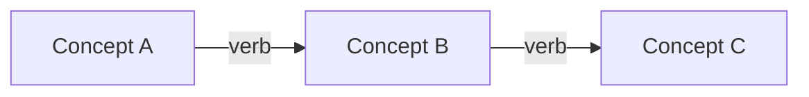
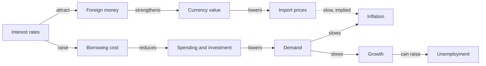

# Flow notes

Flow notes capture ideas and the relationships between them, not the words
of the lecture. Each concept is written once, briefly, and connected to
others with arrows that say how they relate: causes, leads to, depends on,
contradicts. The note ends up looking like a small map of the subject.

The method works because writing a relationship forces understanding.
Copying "inflation erodes savings" takes no thought; drawing an arrow from
"rising prices" to "lower real value of savings" and labeling it means the
note-taker had to decide what causes what. It is slower to review than a
list and does not suit material that is mostly isolated facts, but for
processes, systems, and arguments it builds understanding as the notes are
taken.

## When to use it

- The subject is a process, a system, or a chain of causes (economics,
  biology, history, software architecture).
- Someone wants to understand a topic, not memorize it.
- They have list-style notes and want to see how the points connect.
- They ask for flow notes or flow-based notes.

For a radial overview of a topic, use `mind-map-notes`. For a strict
hierarchy, use `outline-notes`. To check understanding by explaining it
plainly, use `feynman-notes`.

## What to ask for

- **The material**: notes, a reading, a transcript, or a topic.
- **Whether they want a diagram.** Default: text arrows in a list, plus
  Mermaid flowchart code when there are more than about eight links, so it
  can be drawn.

## How to do it

1. Read the whole source and list the **concepts**: the things that act or
   are acted on. Name each in two to four words. Aim for six to fifteen. If
   the source is mostly separate facts with few relationships, say so, build
   chains only for the connected part, and suggest `outline-notes` for the
   rest.
2. Find the **links**. For each pair that relates, write the relationship as
   a verb on the arrow: `causes`, `reduces`, `requires`, `is a kind of`,
   `leads to`, `contradicts`, `is evidence for`. An arrow without a verb is a
   guess at a relationship; always label it.
3. Write each link as one line: `[Concept] → [verb] → [Concept]`. Group the
   lines into **chains** that follow one path through the topic, so the
   reader can trace a sequence start to finish.
4. Look for **loops** (A raises B, B raises A) and **branches** (one cause,
   several effects). Call them out: they are usually the point of the
   lecture. Say whether a loop is **reinforcing** (it amplifies) or
   **balancing** (it damps) when the source says or clearly shows it. Name
   only the loops the source supports (step 6 covers inferred links). A claim
   the source reports as disputed goes here as "Disputed", with who holds
   each side.
5. Add a short note in parentheses only where an arrow needs a condition
   ("only when demand is high") or an example.
6. Mark a link `[?]` when the source implied a relationship without stating
   it, and draw it dotted (`-.->`) in the diagram. Do not present your
   inference as the source's claim.
7. End with two or three sentences that state the big picture the arrows
   show.

## The format

````markdown
# [Topic]
[YYYY-MM-DD] · [Source]

## Concepts
[Concept A] · [Concept B] · [Concept C]

## Chain 1: [What this chain shows]
- [Concept A] → [verb] → [Concept B]
- [Concept B] → [verb] → [Concept C] ([condition or example])

## Loops and branches
- [Reinforcing or balancing] loop: [A → B → A, in one line]
- Branch: [one cause, several effects]

## Big picture
[Two or three sentences.]


````

## Example

Input: "econ: central bank raises interest rates to fight inflation. higher
rates make borrowing expensive so less spending and investment. less demand,
prices rise slower. but also slows growth, can raise unemployment. higher
rates also attract foreign money, stronger currency, cheaper imports"

````markdown
# ECON 102: How rate hikes fight inflation
2026-10-27 · Lecture notes

## Concepts
Interest rates · Borrowing cost · Spending and investment · Demand ·
Inflation · Growth · Unemployment · Foreign money · Currency value ·
Import prices

## Chain 1: The main channel
- Higher interest rates → raise → borrowing cost
- Borrowing cost → reduces → spending and investment
- Less spending → lowers → demand
- Lower demand → slows → inflation

## Chain 2: The cost
- Lower demand → slows → growth
- Slower growth → can raise → unemployment

## Chain 3: The currency channel
- Higher interest rates → attract → foreign money
- Foreign money → strengthens → currency value
- Stronger currency → lowers → import prices
- Cheaper imports → slow → inflation [?] (implied, not stated in the notes)

## Loops and branches
- Branch: lower demand both slows inflation and slows growth. That is the trade-off.

## Big picture
A rate rise slows inflation mainly by making borrowing dearer, and it also
strengthens the currency, which makes imports cheaper. The first path also
slows the economy, which is the cost.


````

## Pitfalls

- **Unlabeled arrows.** "A → B" could mean causes, prevents, or includes.
  Always write the verb.
- **Transcribing in arrow form.** If every line is the next sentence of the
  lecture, it is a list with arrows. Look for the relationships.
- **Too many concepts.** Past about fifteen, the map stops being readable.
  Split it into two notes by sub-topic.
- **Presenting inferred links as facts.** Mark them `[?]` so the person can
  check.
- **Missing the loops.** Feedback loops and trade-offs are often what the
  exam asks about. Look for them on purpose.
- **Mermaid labels that break the diagram.** Parentheses, quotes, or
  subscripts inside a node label (`A[CO₂ (ppm)]`) stop it rendering. Keep
  node labels to plain words and put detail in the text lines.

## Saving the note

If a notes app is connected (for example the Scratchpad connector, or any notes
tool you can call), offer to save the result there as a new note with a clear,
searchable title, or to add it to an existing note the person names. Otherwise,
give the whole note as one Markdown block that pastes cleanly into any notes
app. Keep the Mermaid code in its own fenced block so apps that render Mermaid
can draw it.
