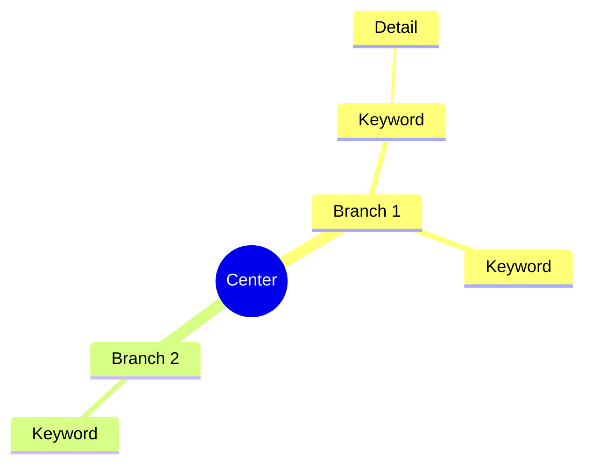
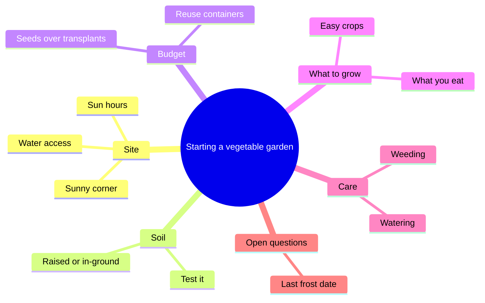

# Mind map notes

A mind map puts one idea in the center and lets branches grow outward:
main themes on the first ring, sub-ideas on the next, details at the tips.
Tony Buzan popularized the form. It works because it shows a whole topic at
once and keeps each idea next to the ones it belongs with, which makes it
good for brainstorming, planning, and seeing the parts of a subject before
studying them in order.

In text, a mind map becomes a nested list: the center is the title, each
branch is a top-level bullet, and the tips are indented beneath. This skill
writes that list, which reads well in any notes app, and can also write
Mermaid `mindmap` code so the person can render it as a picture in any tool
that supports Mermaid.

## When to use it

- Someone wants to brainstorm a project, essay, or problem.
- They want to see a whole topic before studying it in order.
- They have linear notes and want a visual overview of them.
- They ask for a mind map or say they are a visual learner.

For notes that show cause and effect between ideas, use `flow-notes`. For a
strict hierarchy that reads top to bottom, use `outline-notes`. To plan a
hand-drawn visual page, use `sketchnote-planner`. For comparing several
things on the same points, use `charting-notes`.

## What to ask for

- **The center**: the topic, question, or project. If they only gave notes,
  infer the center from them.
- **The material**, if any: notes, a reading, or just their own ideas. With
  no material, brainstorm with them and mark general-knowledge branches
  `(added)` in the list (never in the Mermaid labels).
- **Whether they want Mermaid code.** Default: include it, short, after the
  list. Leave it out if they say they only use plain text.

## How to do it

1. State the **center** in two to five words. A question works well for
   brainstorming ("Why do customers leave?").
2. Find the **main branches**: four to seven themes that together cover the
   topic without overlapping. Fewer than three means the center is too
   narrow; more than eight means some branches belong under others. If the
   material proposes fixes or next steps, give them one branch of their own,
   last, so causes and actions do not mix.
3. Order branches so related ones sit next to each other, as they would
   around a circle. Clockwise from the top is the usual reading order.
4. Grow each branch with **keywords, not sentences**: one to four words per
   node. Short labels are what make a mind map scannable.
5. Go two or three levels deep. Stop when a node is a single concrete fact,
   example, or action.
6. Mark **cross links** (an idea on one branch that relates to another
   branch) as a separate list below the map, since a tree cannot show them.
   A chain of causes (A leads to B leads to C) goes here too; if most of the
   material is chains, suggest `flow-notes` instead.
7. For brainstorming, add a branch called "Open questions" or mark empty
   spots with `[?]`, so the map invites more thinking.
8. Write the Mermaid code last, from the finished list. Keep node labels
   short and free of parentheses, brackets, and colons, which Mermaid can read
   as shape, icon, or class syntax. Indent with two spaces per level. Leave
   `[?]` and `(added)` in the list only: in Mermaid, write a gap as words
   ("Maybe broken") and spell out symbols such as %, ~, and quotes.

## The format

````markdown
# [Center]

- **[Branch 1]**
  - [Keyword]
    - [Detail]
  - [Keyword]
- **[Branch 2]**
  - [Keyword]

**Cross links**
- [Node on branch 1] ↔ [node on branch 2]: [how they relate]


````

## Example

Input: "help me brainstorm starting a small vegetable garden, i have a
sunny back corner, not much money, beginner"

````markdown
# Starting a vegetable garden

- **Site**
  - Sunny back corner
  - [?] Hours of direct sun
  - Water access (added)
- **Soil** (added)
  - Test it
  - Raised bed or in-ground
- **Budget**
  - Seeds over transplants (added)
  - Reuse containers (added)
- **What to grow** (added)
  - Easy beginner crops
  - What you actually eat
- **Care** (added)
  - Watering routine
  - Weeding
- **Open questions**
  - [?] When is the last frost here?

*Only the sunny corner, the budget, and being a beginner came from you.*

**Cross links**
- Raised bed ↔ Budget: raised beds cost more up front (added)


````

## Pitfalls

- **Sentences on branches.** A node that wraps to three lines defeats the
  point. Cut to keywords and put any explanation in a note below.
- **Overlapping branches.** If two branches share most of their children,
  merge them.
- **Too deep.** Past three levels, a mind map turns into an outline. Switch
  formats or split the map.
- **Hiding cross links.** The relationships between branches are often the
  insight. List them rather than dropping them.

## Saving the note

If a notes app is connected (for example the Scratchpad connector, or any notes
tool you can call), offer to save the result there as a new note with a clear,
searchable title, or to add it to an existing note the person names. Otherwise,
give the whole note as one Markdown block that pastes cleanly into any notes
app. Keep the Mermaid code in its own fenced block so apps that render Mermaid
can draw it.
